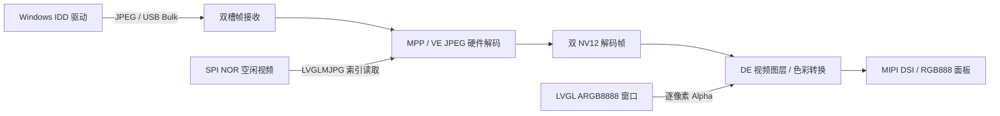
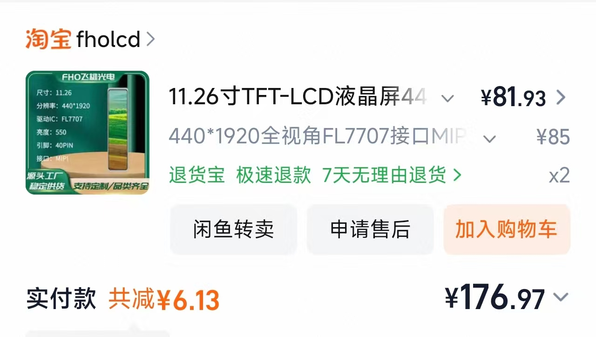

# AIC-BarDisplay

> **本工程派生自 [https://github.com/panyihang/AIC-BarDisplay](https://github.com/panyihang/AIC-BarDisplay)**

**匠芯创 D125 / D133 长条 USB 副屏固件平台**

AIC-BarDisplay 将 ArtInChip Luban-Lite 中实际使用的 bootloader、芯片底层、RT-Thread/OSAL、CherryUSB、MPP 和 LVGL 剥离为独立固件工程。面向 **8 MiB PSRAM + 32 MiB SPI NOR** 硬件，使用主机 JPEG 帧传输、芯片硬件解码与 DE 图层合成，生成三款 MIPI DSI 长条屏在两种主控上的六个固件版本，并在派生后叠加了若干屏参变体与调屏调试变体（见下）。

在原始工程的基础上，本仓库新增了三块内容：

- **`dispdbg` 在线调屏命令**：无需重刷固件即可在线修改时序/DSI 参数、改分辨率、发任意 DCS 命令、填充测试图样，用于未知屏的 bring-up。见 [在线调屏命令 `dispdbg`](#在线调屏命令-dispdbg)。
- **USB-CDC 调试固件**：在没有 UART 引出时，把 RT-Thread 控制台重定向到 USB CDC-ACM 虚拟串口，Windows 免驱识别为 COM 口，直接交互跑 `dispdbg` 调屏。多个配套调试变体见 [USB-CDC 调试固件](#usb-cdc-调试固件)。
- **适配的 FL7707N AV093X 面板驱动**：新增 BOE AV093XHQ-N10（320×1280，4-lane MIPI-DSI）面板支持，并带有正式的副屏固件变体。见 [FL7707N AV093X 面板](#fl7707n-av093x-面板)。

相比此前采用闭源副屏库的方案，开源版性能更优（更好的JPEG解码质量），显示效果更优（原RGB565 -> 全链路RGB888），稳定性更优（透明且更为合理的RAM管理）

## 技术架构



- **传输与解码分离**：USB 回调负责收包与帧状态推进，不在回调内分配内存、等待阻塞锁或执行 JPEG 解码。
- **硬件视频通路**：JPEG 帧经 VE 解码为 NV12，由 DE 视频图层显示并完成输出色彩转换。
- **原生分辨率**：设备向主机声明实际宽高。
- **逐像素透明合成**：待机/设置 UI 使用 ARGB8888，独立于 NV12 视频层；
- **受控内存生命周期**：空闲视频与副屏共用 RX 缓冲和解码资源；进入副屏时清理 LVGL 页面对象及动画，保留可复用的 LVGL 核心与 display 实例。
- **固定固件生成链**：Python 直接调度 GCC、链接脚本、文件系统生成器和 IMG 打包器，无需原 SDK、SCons、Kconfig、Python 2 或联网安装。


## 硬件与屏幕

使用 [开源 D125/D133 双 PCB 硬件方案](https://oshwhub.com/an_ye/project_tebvlwzd)。请选择与实际 PCB 主控一致的固件；本工程中 D125 对应 `d12p`，D133 对应 `d13x`。

默认分区和 IMG 按 **32 MiB（256 Mbit，Q256 容量级）SPI NOR** 配置，需要贴装兼容的 32 MiB Flash；

| 屏幕 | 原生分辨率（宽×高） | D125 固件 | D133 固件 |
| --- | --- | --- | --- |
| TXW935003B | 480×1920 | [d125-txw935003b.img](images/d125-txw935003b.img) | [d133-txw935003b.img](images/d133-txw935003b.img) |
| BOE1126 | 440×1920 | [d125-boe1126.img](images/d125-boe1126.img) | [d133-boe1126.img](images/d133-boe1126.img) |
| AV092K5U | 462×1920 | [d125-av092k5u.img](images/d125-av092k5u.img) | [d133-av092k5u.img](images/d133-av092k5u.img) |
| AV093X | 320×1280 | — | [d133-boe-av093x.img](images/d133-boe-av093x.img) |

| AV092K5U | BOE1126 |
| --- | --- |
|  |  |

TXW935003B 来自 360 行车记录仪拆机屏，适配过程涉及缺少完整厂商资料时的接口与初始化序列分析，相关记录见 [360 MX30 9.35 英寸 MIPI 屏项目](https://github.com/panyihang/360_MX30_9-35-MIPI_DISPLAY)。当前固件采用的有效分辨率为 **480×1920**。


## USB 协议与主机驱动

设备组合提供三类接口：

| 接口 | 功能 |
| --- | --- |
| Vendor / Bulk | 接收主机 JPEG 副屏帧；应用采用 16 字节协议头与两槽接收队列 |
| HID | 保留五点触摸报告协议；当前 PCB 无触摸输入，不产生实际触点 |
| MSC | 暴露只读 FAT 资源盘，包含 Windows 驱动安装包和空闲视频；拒绝写入 |

Windows 端参考开源 IDD 协议。将匹配的 IMG 烧录后，通过 USB 数据线连接主机，从资源盘获取 `usb_graphic_250224.exe`，完成驱动安装后在 Windows 显示设置中配置副屏。

设备产品字符串与 Vendor 接口字符串携带能力声明，例如：

```text
esp32p4udisp0_R480x1920_Ejpg6_Fps60_Bl292
```

其中 `R` 为原生宽高，`Ejpg6` 为驱动协议的 JPEG 质量档位，`Fps60` 为主机提交帧率上限，`Bl292` 为压缩帧预算（KiB）。固件单帧接收上限为 **300,000 bytes**，对主机向下声明为 292 KiB。

**60 FPS 是协议声明上限，不是六款固件的实测持续帧率承诺。** 实际吞吐取决于画面内容、JPEG 大小、USB 传输和解码/呈现耗时。面板扫描刷新率还受 `pixelclock` 与水平/垂直总时序约束，不能仅通过修改 `fps` 改变。

## 8 MiB PSRAM 下的显示与内存布局

以 480×1920 的 TXW935003B 为例：

| 资源 | 配置与用途 | 量级 |
| --- | --- | --- |
| 基础 framebuffer | 一份全屏 RGB888 分配 | 2,764,800 bytes，约 2.64 MiB |
| JPEG RX | 两槽，每槽 300,000 bytes；空闲视频复用其中一槽 | 600,000 bytes，约 0.57 MiB |
| 解码输出 | 两份全屏 NV12，保留可见帧至下一帧切换 | 合计约 2.64 MiB |
| 待机 UI | 两个 400×480 ARGB8888 窗口，复用基础 framebuffer 分配 | 1,536,000 bytes，**不额外叠加分配** |
| PSRAM SW 保留区 | 应用固定配置为 1 MiB | 其余预算用于 CMA/多媒体资源 |

待机 UI 是居中的 1:1 窗口，双缓冲整窗渲染后切换；背景视频由 DE 视频层扫描输出。副屏模式关闭 UI 图层并释放页面对象，避免 LVGL 与解码器争抢额外的大块内存。

副屏运行时串口周期输出 `usbdisp perf`，包含接收字节率、完整帧/丢帧计数、解码与显示速率、平均耗时及错误计数。可据此区分传输、解码和显示瓶颈；它是工作线程内的诊断，线程阻塞时日志也可能停止。

## 空闲视频、设置与 Flash

空闲页循环播放 `application/rt-thread/usbdisp/assets/video/video.bin`。当前资源采用参考工程的 `LVGLMJPG` 容器：64 字节头、逐帧偏移/长度索引和独立 JPEG 帧。索引按需从 Flash 读取，不常驻缓存整张索引表。

当前视频为 **480×1920、30 FPS、602 帧**，使用 baseline JPEG / 4:2:0，编码质量 33，大小 25,908,703 bytes；最大单帧 45,153 bytes。质量 33 是此视频资源的编码参数，与 USB 驱动协议的 `Ejpg6` 不同。窄屏使用居中且符合色度对齐要求的裁剪，不缩放。

设置页由 LVGL 实现，隐藏待机页、HID 开关等设置保存到 `/data/udisp.cfg`。当前无物理触摸，设置可通过串口命令操作；、

串口控制台：D125 使用 UART0，D133 使用 UART6，115200 / 8N1。空闲页状态下可执行：

```text
udisp settings       # 打开设置页
udisp back           # 返回空闲页
udisp page_hide 1    # 隐藏待机页；0 恢复
udisp hid 0          # 关闭 HID 触摸报告；1 开启
udisp status         # 查看连接、帧与错误计数
```

| 分区 | D125 | D133 | 用途 |
| --- | --- | --- | --- |
| `spl` | 512 KiB | 512 KiB | 共享 bootloader |
| `env` / `env_r` | 各 128 KiB | 各 128 KiB | 环境变量及冗余副本 |
| `userid` | 256 KiB | — | D125 保留分区 |
| `os` | 3 MiB | 3 MiB | 副屏应用 |
| `rodata` | 27 MiB | 27 MiB | 只读 FAT 资源盘 |
| `data` | 1 MiB | 1 MiB | 可写设置区 |

具体布局以 `target/<chip>/display-nor/pack/image_cfg.json` 为准。镜像内包含 bootloader 和应用，同一芯片的三款屏复用一套 bootloader，屏参差异进入应用固件。

## 本地生成固件

Windows 64 位，工程内置 GCC 和 Python 运行时。将工程放在**不含空格的路径**，在命令行运行：

```bat
build.cmd                                 :: 编译全部六个版本
build.cmd d125-txw935003b                  :: 只编译一个版本
build.cmd d125-boe1126 d133-boe1126         :: 同时选择多个版本
build.cmd --list                          :: 列出版本
build.cmd --jobs 8 --keep-build            :: 保留 ELF、map、编译日志和缓存
build.cmd --clean                         :: 删除 build/ 和 images/，包括已生成 IMG
```

输出为 `images/<版本>.img`，本次选择的镜像清单及 SHA256 写入 `images/manifest.json`。成功构建默认清理中间文件；失败时保留 `build/` 便于诊断。

每次生成均检查打包组件范围、IMG 内 bootloader/资源内容、视频文件 SHA256 和 32 MiB NOR 分区边界。已有两套 bootloader 与六个应用的编译/打包验证记录见 `images/validation.json`；编译与资源检查通过不替代实际 PCB 上的显示、连续传输和模式切换测试。

## 在线调屏命令 `dispdbg`

`dispdbg` 是注册在 RT-Thread finsh 控制台（`aic>` 提示符）的一条在线调屏命令，用于**未知屏的 bring-up**：不需要重刷固件，直接在控制台修改内存中的 `panel->timings`（DE 与 DSI 都从这个指针读取），并完成一次面板 OFF/ON 热重载，即可在线套用新参数。

### 怎么用：三步走

**第 1 步：进入控制台。** 有 UART 引出时用串口（D125=UART0 / D133=UART6，115200 / 8N1）；没有 UART 时用 [USB-CDC 调试固件](#usb-cdc-调试固件)，Windows 免驱识别为 COM 口，任意波特率连上按回车即出现 `aic>`。屏幕无关 UART、由 `aicfb_probe` 自动初始化，开机即画五色棋盘并注册 `dispdbg`——CDC 调试固件照常驱动屏幕和控制台。

**第 2 步：按序排查。** 先确认基线，再按现象逐步逼近：

```text
dispdbg info          # ① 核对当前时序/DSI/fb 参数
dispdbg pattern 1     # ② 全白：数据链路是否通
dispdbg pattern 2     # ③ 全黑：黑不黑（不黑＝反相/窗口异常）
dispdbg pattern 6     # ④ 水平灰阶：观察灰阶过渡/反相
```
- 全白/全黑能干净切换 → 数据通路基本健康，重点查分辨率/lane。
- 纯色屏仍带噪点/条纹 → 优先查物理层（lane 顺序/极性/速率），用 `dispdbg set`。

**反相**（全黑显示偏白是反相典型特征）：
```text
dispdbg cmd 0x21      # ENTER_INVERT_MODE，全黑变黑、全白变白即确认
dispdbg cmd 0x20      # EXIT_INVERT_MODE 恢复
```
确认后把 `0x21` 固化进面板驱动的 init 序列（exit sleep 后、display on 前），见下方[回填参数](#回填参数)。

**格式 / 方向**（面板可能从未被告知格式）：
```text
dispdbg cmd 0x3a 0x77      # 面板声明 24bpp RGB888
dispdbg set fmt 0          # SoC 侧输出 RGB888（0）
dispdbg cmd 0x36 0x00      # MADCTL 默认方向
dispdbg cmd 0x2a 0x00 0x00 0x01 0xb7  # CASET 0..439
dispdbg cmd 0x2b 0x00 0x00 0x07 0x7f  # RASET 0..1919
```
哪一组出现干净纯色，哪组就是正确格式。

**分辨率互换试验**（像素数相同、fb 够用时）：
```text
dispdbg res 1920 440      # 与 440×1920 互换
dispdbg pattern 6         # 看渐变方向与均匀度
dispdbg res 440 1920      # 恢复
```

**扇区/lane 试探**（每次改动自动重启面板，拍照记录）：
```text
dispdbg set assign 0x321   # 恢复正序，看是否改善
dispdbg set polrs 0xFFFF   # 极性全翻转试探
dispdbg set lane 2         # 降 2 lane（速率减半，抗误码）
dispdbg set fps 50         # 降帧率试探（pclk、lane rate 随之下降）
```

**第 3 步：回填参数。** `dispdbg set` 改的只是**内存值、免重烧、掉电失效**。调通后把最终值写回 `variants.json` 对应变体的 `timing` 段（`width/height` 是编译期宏 `FIRMWARE_WIDTH/HEIGHT`，`dispdbg` 改不了，需重编），按 `pixelclock = (w+hfp+hbp+hsync) × (h+vfp+vbp+vsync) × fps` 重算，然后重新构建正式固件：

```bat
.\build.cmd d133-boe1126        :: 换成你的版本
```

### 命令参考

| 子命令 | 作用 |
| --- | --- |
| `dispdbg`（无参数） | 打印完整帮助 |
| `dispdbg info` | 打印当前生效的时序/DSI/fb 参数，含换算出的 fps |
| `dispdbg set <key> <value>` | 在线修改单个参数并自动重启面板。key 支持 `pclk` `hfp` `hbp` `hsync` `vfp` `vbp` `vsync` `fps`（按 htotal×vtotal×fps 重算 pclk）`lane` `assign`（十进制或 0x 前缀）`polrs` `fmt`（0=RGB888 1=RGB666L 2=RGB666 3=RGB565） |
| `dispdbg res <w> <h>` | 在线改分辨率，按 60Hz 自动重算 pclk，并同步 width/height/stride/fb_size；超过已分配 framebuffer 会拒绝执行 |
| `dispdbg cmd <c> [p0 p1 ...]` | 运行时发送任意 DCS 命令，自动切 command 模式发完再切回 video，如 `cmd 0x3a 0x77`（COLMOD）、`cmd 0x36 0x00`（MADCTL） |
| `dispdbg read <cmd>` | 读 DSI 回包 FIFO（面板回包低 24bit）；配套新增了 `dsi_cmd_rd()` 与 `aic_dsi_read_cmd()` 从 RX FIFO 读回。**不可用于读屏 ID**——识别未知屏建议拆机看丝印或参数扫描 |
| `dispdbg pattern <id>` | 填充测试图：0 五色棋盘 1 全白 2 全黑 3 红 4 绿 5 蓝 6 水平灰阶 7 垂直灰阶 |
| `dispdbg reset` | 用当前内存参数重新初始化面板（OFF→延时→ON，含完整 init 序列） |

### 实现要点（源码位于 `bsp/artinchip/drv/display/drv_fb.c`）

- **热重载前先停 DE 并切换时钟**：否则 DE 持续扫描一个已无活的 DSI 流在后的 framebuffer，报 DE UNDERFLOW，DSI PHY 也握手失败。
- **重跑 `attach_panel()`**：DSS/PLL 时钟率只在 `dsi_attach_panel()` 内由 `pixclk × bpp / lanes` 推导，`set pclk/fps/lane` 改参数后必须重新 attach，D-PHY HS 时钟与 PIX 时钟才会跟踪新时序。
- **处理 DE 硬复位清寄存器**：`enable_clk(OFF)` 会硬复位整个 DE，清掉 UI 图层 master-enable 和格式位；软件副本 `layers[].enable` 仍为 1，导致重使能被跳过、屏幕亮起但不扫描。`dispdbg_reload()` 先强制禁用图层再走重使能路径。
- **图层与缓冲在时序就绪后重新关联**：否则 DE 扫描未关联的图层，屏幕变黑。
- **`pattern` 会填满所有 draw buffer**：避免 DE 正扫描别的 buf 时看不到图案。填充 440×1920×3 ≈ 2.5MB 在 480MHz 上需数百毫秒~1 秒，看到"边填边显示"的渐变是填充耗时，不是故障。
- **`cmd` 会自动切换视频模式**：`aic_dsi_send_cmd()` 本身不动视频模式配置，面板驱动靠 `panel_dsi_send_perpare()` 先切 command 模式再发，`dispdbg cmd` 已封装好这一过程。

完整的决策树与历史调试记录见 `doc/未知屏调试指南-d133-boe1126.md`，CDC 调试固件的连接细节见 `doc/USB-CDC调试固件使用说明.md`。

## USB-CDC 调试固件

开发板没有预留 UART 引出时，RT-Thread 控制台默认绑定 `uart6`，无法交互。`dispdbg` 调屏也就用不上。为解决这个问题，本仓库新增了一系列**独立的 CDC 调试固件变体**：把控制台重定向到 USB CDC-ACM 虚拟串口，Windows 免驱识别为标准 COM 口，连上 USB Device 口即可直接跑 `dispdbg`。

为什么用独立变体而不是改正式固件：

- 正式固件的 USB 口已被 usbdisp 复合设备（vendor+HID+MSC）占用，那是给 PC 端投屏用的，不能同时当控制台。
- 独立变体把 USB 完全让给 CDC 控制台，设备标识 VID `0x303A` / PID `0x2988`，产品名 “D133 CDC Console”。
- **不影响正式固件**：两者是不同的 graph/config/变体，正式固件照常构建。

关键前提（已核实）：屏幕显示由 `aicfb_probe` 通过 `INIT_DEVICE_EXPORT` 自动初始化，开机即画五色棋盘测试图并注册 `dispdbg`，不依赖任何应用逻辑。所以调试固件砍掉 usbdisp/LVGL/mpp 后，屏幕依旧正常驱动，控制台依旧可用。

桥接层（`application/rt-thread/cdcdebug/cdc_console.c`）工作原理：

- **输出**：`rt_kprintf` → console 设备 `vcom` 的 write 回调 → TX 环形缓冲 → CDC bulk IN 端点发往 PC。USB 未枚举前的输出先存缓冲，枚举完成后自动补发。
- **输入**：CDC bulk OUT 端点收到 PC 数据 → RX 环形缓冲 → `rx_indicate` 唤醒 finsh shell 线程 → 即可交互。
- 设备注册在 `INIT_DEVICE_EXPORT`（早于 finsh），USB 控制器启动在 `INIT_APP_EXPORT`，时序安全。

USB-CDC 相关变体：

| 变体 | 用途 |
| --- | --- |
| `d133-boe1126-cdc` | BOE1126（440×1920）调屏基准 CDC 调试固件 |
| `d133-boe1126-av092k5u-test` | AV092K5U 测试变体（换 AV092K5U 面板） |
| `d133-txw935003b-cdc` | TXW935003B 调屏 CDC 调试固件 |
| `d133-boe-av093x-cdc` | AV093X（320×1280）调屏 CDC 调试固件 |

各变体由 `tools/gen_*_cdc_variant.py` / `tools/gen_av093x_cdc_variant.py` 等生成脚本从正式变体派生（换面板源、换面板宏与 GPIO、换时序），脚本可重复运行。使用说明见 `doc/USB-CDC调试固件使用说明.md`，TXW935003B 的调试记录见 `doc/TXW935003B调试记录.md`。

## FL7707N AV093X 面板

新增 **BOE AV093XHQ-N10（320×1280，4-lane MIPI-DSI）** 面板支持，驱动器 IC 为 FL7707N。面板驱动位于 `bsp/artinchip/drv/display/panel/panel_dsi_fl7707_av093x_b.c`。

- **接线沿用同系列 FL7707N 的 DSI 走线与控制脚**（与 BOE1126 参考屏一致）：数据 lane 反接（`ln_assign 0x0123`），`DSI_RST=PD.16`、`LCD_PEN=PD.15`、`BL_PWM=PD.10`。
- **上电时序**：`LCD_PEN` 上电即刻拉低并保持低电平（active low），随后 `DSI_RST` 复位脉冲。
- 初始化序列取自厂商代码文档 `AV093XHQ-N10_IPS_Code_正掃_2 Power_V4.3_20221026(2).txt`，含完整的 DCS 寄存器表、退出睡眠与开显示序列。
- **时序/DSI lane 速率要点**：AV093X 的**正式副屏固件**时序为 `htotal = 320+150+150+60 = 680`、`vtotal = 1280+150+164+4 = 1598`，`pixelclock = 680 × 1598 × 60 = 65.1984 MHz`，DSI HS lane 速率约 **391 Mbps/lane**。
  - 这是**调屏踩坑后的修正**：初始采用最小帧（`htotal=430`、`vtotal=1311`、`pixelclock≈33.8 MHz`）时 lane 速率仅约 203 Mbps/lane，FL7707N 的 TCON PLL/CDR 在如此低且持续的 HS lane 速率下无法保持锁定，表现为“开机一帧后有画面，随后慢慢黑屏”。
  - 修正方案：**通过加大 blanking 抬升 pixelclock / lane 速率**，向已核验稳定的 BOE1126 参考（65.856 MHz / ~395 Mbps/lane）看齐。点时钟仍为 sclk 的 /6 整数分频，`CLK_PIX` 与 60 Hz 刷新保持精确，只是 blanking 占空比变大，TCON 可容忍。详见 `tools/gen_av093x_cdc_variant.py` 顶部注释。

正式副屏固件变体为 `d133-boe-av093x`（D133，非 CDC），使用独立的 `assets_av093x` 空闲视频资源目录（320×1280 LVGLMJPG 片断）。CDC 调屏变体为 `d133-boe-av093x-cdc`。

## 添加屏参版本

入口为 `variants.json`，每个条目由芯片/屏初始化模板和基础参数组成：

| 字段 | 作用 |
| --- | --- |
| 版本条目名称 | 命令行选择名及 IMG 文件名，例如 `d125-txw935003b` |
| `chip` / `graph` | 芯片及固定源码/编译模板，不能跨 D125/D133 混用 |
| `product` / `version` | IMG 产品标识与版本号 |
| `timing.width` / `height` | 原生分辨率，也用于 USB 能力声明；NV12 要求宽高为偶数 |
| `pixelclock` | 面板像素时钟，单位 Hz |
| `hfront_porch` / `hback_porch` / `hsync_len` | 水平前肩、后肩、同步宽度，单位像素时钟 |
| `vfront_porch` / `vback_porch` / `vsync_len` | 垂直前肩、后肩、同步宽度，单位行 |
| `lane_num` / `ln_assign` / `ln_polrs` | DSI lane 数量、映射与极性；JSON 使用十进制数 |
| `fps` / `jpeg_quality` | 主机协议的帧率上限与 JPEG 质量档位 |

同一面板控制器、兼容 PCB/初始化序列下，复制一个条目、修改唯一名称和参数即可生成新版本。`ln_assign: 291` 对应 `0x0123`。扫描刷新率可按 `pixelclock / (水平总像素 × 垂直总行数)` 核算，配置时应与屏规格对应。

更换控制器或面板寄存器初始化表时，还需修改 `bsp/artinchip/drv/display/panel/` 下的驱动，并更新 `firmware/graphs/`、`firmware/configs/` 中对应模板。仅修改 JSON 不能自动适配未知屏；

## 关键源码

| 位置 | 内容 |
| --- | --- |
| `build.py`、`build.cmd` | 专用编译、配置头生成、打包、验证与清理入口 |
| `variants.json` | 各版本及后续屏参变体（含 CDC 调试变体） |
| `firmware/configs/`、`firmware/graphs/` | 固定配置头、实际参与编译的源码与库清单 |
| `application/rt-thread/usbdisp/` | USB 帧接收、解码呈现、LVGL UI、资源视频与设置 |
| `application/rt-thread/cdcdebug/` | USB-CDC 调屏控制台的桥接层与精简应用入口 |
| `bsp/artinchip/` | 芯片启动、HAL/驱动及多款面板初始化 |
| `bsp/artinchip/drv/display/drv_fb.c` | `dispdbg` 在线调屏命令 |
| `bsp/artinchip/drv/display/panel/` | 面板驱动，含新增的 `panel_dsi_fl7707_av093x_b.c` |
| `packages/third-party/cherryusb/class/cdc/` | 从参考工程移植的 CDC ACM 类实现 |
| `tools/gen_*_cdc_variant.py`、`tools/gen_av093x_*_variant.py` | 从正式变体派生 CDC / AV093X 变体的生成脚本 |
| `application/baremetal/bootloader/` | 芯片共用的启动与升级代码 |
| `kernel/`、`packages/` | 经实际依赖裁剪的 OS、USB、文件系统、MPP、LVGL 基础 |

工程采用显式源码清单，不再提供通用 SDK 配置菜单。构建工具可独立运行，保留的底层源码目录便于定位硬件问题。调屏/调试相关文档见 `doc/未知屏调试指南-d133-boe1126.md`、`doc/USB-CDC调试固件使用说明.md`、`doc/TXW935003B调试记录.md`。